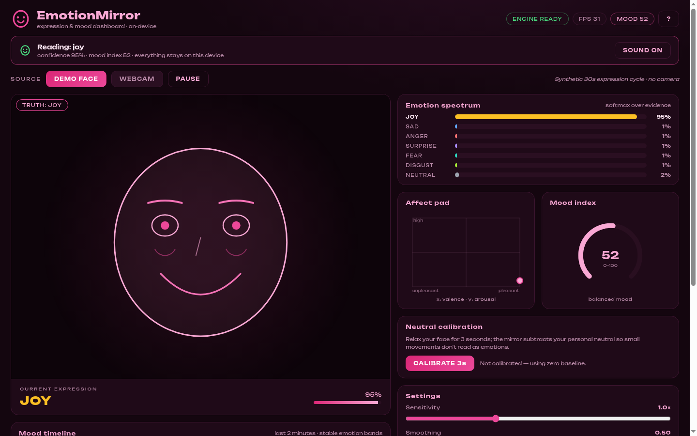
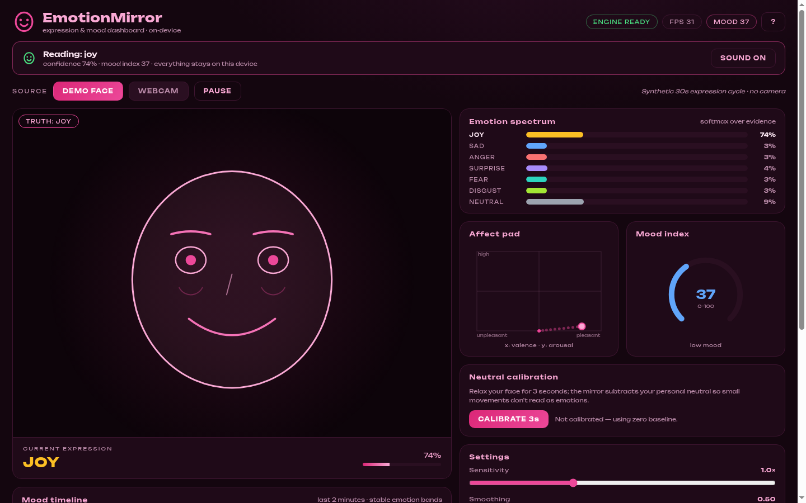
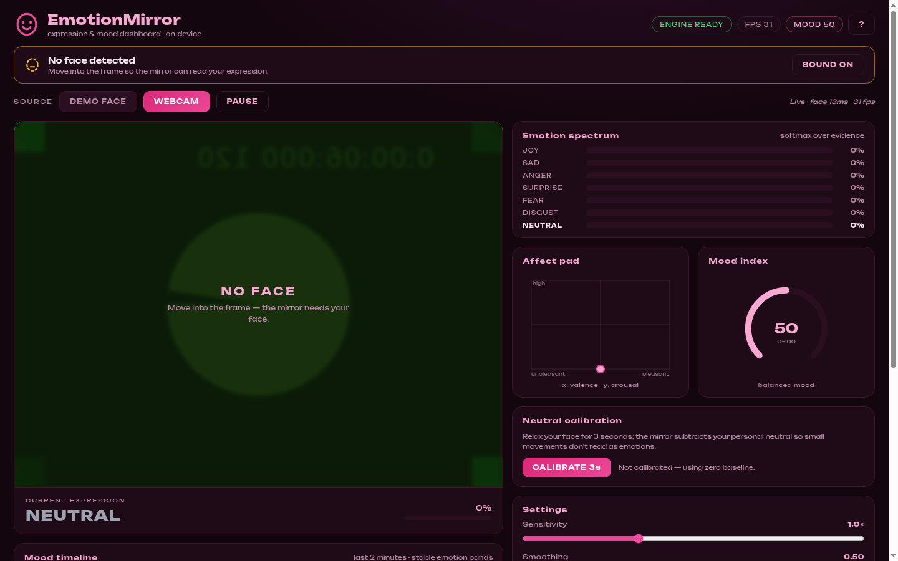
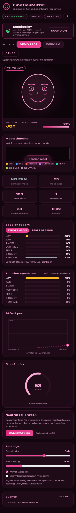

# EmotionMirror — Expression & Mood Dashboard

A Chrome extension that reads your facial expressions **entirely on-device**
and turns them into a live mood dashboard: 7 emotions, a valence–arousal
affect map, a mood timeline, and exportable session reports. Video never
leaves the page — MediaPipe FaceLandmarker runs locally in WebAssembly.



## Features

- **7-emotion spectrum** — joy, sadness, anger, surprise, fear, disgust and
  neutral, scored by a transparent rule engine over the 52 ARKit-style
  blendshapes, normalized with softmax and stabilized with a 4-frame gate.
- **Affect pad** — your expression placed on the classic circumplex map
  (valence −1..1 × arousal 0..1) with a fading trail.
- **Mood index** — a time-weighted moving average of valence (0–100) drawn
  as a gauge ring; time-weighting keeps it honest under background-tab
  throttling.
- **Mood timeline** — color-coded emotion bands over the last 2 minutes.
- **Session report** — dwell % per emotion, transitions, longest streak,
  blink count, smile score; exportable as JSON.
- **Neutral calibration** — hold a relaxed face for 3 s; your personal
  neutral offsets are subtracted so small habitual movements don't read as
  emotions. Persisted in `chrome.storage`.
- **Demo face** — a synthetic animated face cycles through all expressions
  with ground-truth labels (30 s cycle), so the whole pipeline can be
  verified without a camera.
- **Webcam mode** — mirrored preview, optional landmark mesh overlay,
  live FPS / inference-time readout, NO FACE veil when you leave the frame.
- **Tuning** — sensitivity (0.5–2×) and smoothing (0–0.9) sliders, mirror
  and mesh toggles, sound feedback.
- **Plum & magenta UI** with the Unbounded typeface, responsive to 390 px.

| Demo | Webcam (no face) | Mobile |
|---|---|---|
|  |  |  |

## How it works

```
webcam / demo blendshapes ──► 13 symmetric features ──► baseline + sensitivity
      ──► EMA smoothing ──► emotion evidence scores ──► softmax + 4-frame gate
      ──► spectrum · affect pad · mood index · timeline · session report
```

### Emotion recipes (`js/emotion.js`)

Each emotion is a weighted recipe of facial-action features (all clamped ≥ 0):

| Emotion | Main positive evidence | Main suppression |
|---|---|---|
| JOY | mouthSmile ×1.5, cheekSquint (Duchenne) ×0.35 | frown, browDown |
| SAD | mouthFrown ×1.3, browInnerUp ×0.7 | smile, eyeWide |
| ANGER | browDown ×1.2, noseSneer ×0.5, mouthPress ×0.45 | smile, browInnerUp |
| SURPRISE | eyeWide ×0.95, browOuterUp ×0.55, jawOpen ×0.55 | frown, browDown |
| FEAR | browInnerUp ×0.8, eyeWide ×0.7 | jawOpen, smile |
| DISGUST | noseSneer ×1.25, browDown ×0.35, mouthPress ×0.3 | smile, eyeWide |
| NEUTRAL | constant floor 0.3 (wins when nothing fires) | — |

Valence = 1.3·smile − 1.1·frown − 0.6·browDown − 0.5·sneer − 0.3·browInnerUp.
Arousal = 0.7·eyeWide + 0.6·jawOpen + 0.4·browInnerUp + 0.35·browOuterUp + 0.25·browDown.

### Demo ground truth (`js/demo.js`)

30 s cycle: NEUTRAL 4 s → JOY 6 s → SURPRISE 4 s → SAD 5 s → ANGER 5 s →
DISGUST 3 s → NEUTRAL 3 s, with 500 ms cross-fades and two blinks. The demo
synthesizes blendshape values directly (same shape as the real engine
output) and draws a 2D face that mirrors them — brows, eyes, mouth and
nose wrinkles all animate from the same numbers the classifier sees.

## Honest limits

- **Expression ≠ emotion.** Blendshapes measure facial movement, not
  feelings. People mask, pose and differ culturally; this is a wellness
  toy, not a psychological instrument.
- **Rule-based, not learned.** The recipes are hand-tuned weights; unusual
  faces, glasses, beards or strong lighting can shift the readings.
- **FEAR vs SURPRISE** is inherently ambiguous (both raise brows and widen
  eyes); the separator is jaw opening, which is imperfect.
- **Single face only** — the engine tracks one face; others in frame are ignored.
- **CPU inference** — ~13–20 ms per frame on a modest CPU; fine at 30 fps,
  but slower machines will drop frames.
- **Mood index is a moving average of valence**, not a clinical mood measure.

## Install (developer mode)

1. Clone or download this repository.
2. Open `chrome://extensions`, enable **Developer mode**.
3. **Load unpacked** → select the repository folder.
4. Click the EmotionMirror toolbar icon — the demo face starts automatically;
   press WEBCAM to use your camera.

Permissions: `storage` only. The camera is requested via `getUserMedia` only
when you press WEBCAM, and frames are never recorded or uploaded.

## E2E test harness

Same harness as the sibling projects: headful Chromium under
`xvfb-run -a -s "-screen 0 1440x900x24"` driven by `puppeteer-core`, with
`--use-fake-device-for-media-stream --use-fake-ui-for-media-stream`,
`--enable-unsafe-swiftshader`, `--load-extension=<dir>`. Debug hooks on
`window.__em`.

| Check | Result |
|---|---|
| Extension loads, service worker detected | pass |
| FaceLandmarker engine ready (52 blendshapes, CPU) | pass |
| Demo cycle: every truth phase classified correctly (1 transition frame each) | pass |
| Confidences: JOY .95 / SURPRISE .94 / SAD .89 / ANGER .85 / DISGUST .68 | pass |
| Affect: JOY valence +, SAD/ANGER/DISGUST −, SURPRISE arousal 1.0 | pass |
| Mood index swings 17–76 across the cycle; 2 blinks/cycle counted | pass |
| Neutral calibration: n=92 samples, persisted | pass |
| Sensitivity + smoothing sliders persist and reset | pass |
| Pause freezes frame counter, veil shown | pass |
| Webcam (fake device): 28–31 fps, ~13–16 ms inference, NO FACE veil + banner | pass |
| Landmark mesh toggle | pass |
| Session JSON export toast; reset zeroes dwell/transitions | pass |
| Log clear, help modal | pass |
| Mobile 390 px: no horizontal overflow | pass |
| Console / page errors | none |

## Repository layout

```
manifest.json      MV3 manifest (storage only, wasm-unsafe-eval CSP)
background.js      toolbar click → opens app.html
app.html/css/      plum/magenta UI (Unbounded)
js/emotion.js      pure feature extraction, recipes, affect, MoodTracker
js/engine.js       FaceLandmarker init + detectForVideo wrapper
js/demo.js         30s blendshape cycle + animated 2D face
js/app.js          state, stability gate, canvases, report, debug hooks
vendor/            MediaPipe vision bundle + WASM + face_landmarker.task
icons/ docs/       extension icons, screenshots
```

## Credits & licenses

- Code: MIT (see `LICENSE`).
- [MediaPipe Tasks Vision](https://github.com/google-ai-edge/mediapipe) — Apache-2.0.
- Face Landmarker model (with blendshapes) — Apache-2.0, © Google.
- [Unbounded](https://fonts.google.com/specimen/Unbounded) — SIL OFL 1.1.